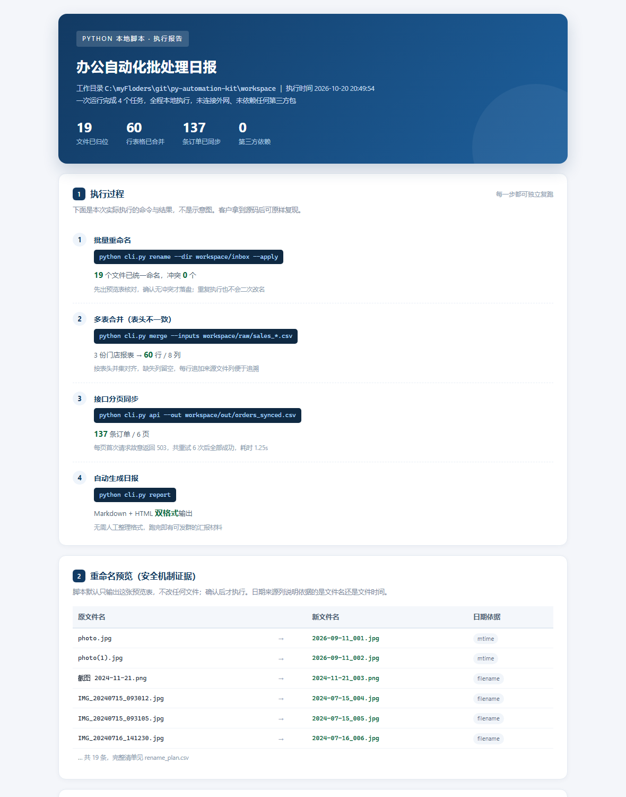

# py-automation-kit

> 本地运行的 Python 办公自动化脚本工具箱 · **零第三方依赖** · 一个 `python` 命令跑完

面向「重复性文件与表格工作」的可交付脚本集合。所有能力都在本地完成，不上传文件、不连数据库、不需要服务器，客户电脑装个 Python 就能用。

**跑出来长这样**（真实运行产物截图，非示意图）：



---

## 零、操作步骤（照着敲，约 3 分钟）

> 命令按 **Windows 命令提示符 cmd** 写。macOS / Linux 把 `python` 换成 `python3`、路径换成 `/你的路径/py-automation-kit` 即可。

### 步骤 1｜确认 Python 可用

```bat
python --version
```

期望看到 `Python 3.8` 及以上（本项目实测 3.13.12）。
若提示「'python' 不是内部或外部命令」，改用 `py -3 --version`。

### 步骤 2｜进入项目目录

```bat
cd /d C:\myFloders\git\py-automation-kit
```

路径按你实际存放位置改。`cd /d` 用于跨盘符切换，漏掉 `/d` 会切换不过去。

### 步骤 3｜一条命令跑完整演示

```bat
python cli.py demo
```

约 2 秒跑完，依次打印 5 步：

```
[INFO] Step 1/5 生成演示数据
[INFO] Step 2/5 批量重命名（先预览、无冲突再落盘）
[INFO] Step 3/5 合并三份门店报表（表头不一致自动对齐）
[INFO] Step 4/5 接口分页同步（含首次失败重试）
[INFO] Step 5/5 生成运行日报
```

看到 `日报已生成` 即成功。**全程不需要联网**——接口是脚本自己拉起的本地 Mock 服务（随机端口，用完即关）。

### 步骤 4｜打开产物看结果

| 顺序 | 文件 | 能看到什么 |
| --- | --- | --- |
| ① | `workspace\out\daily_report.html` | **建议先开这个**：一页看完执行了哪些命令、每个步骤的结果、重命名安全机制的证据 |
| ② | `workspace\out\rename_plan.csv` | 改名前后对照表（预览，此步尚未改动磁盘文件） |
| ③ | `workspace\out\merged_sales.csv` | 3 份表头不一致的门店报表合成 60 行，末列标注来源文件 |
| ④ | `workspace\out\orders_synced.csv` | 分页同步 137 行，每页首请求模拟失败后重试成功 |
| ⑤ | `workspace\out\api_sync.log` | 逐页同步日志，重试过程逐条留痕 |
| ⑥ | `workspace\inbox\` | 重命名后的文件（19 个已按 `日期_序号` 统一） |

打开方式：`start workspace\out\daily_report.html`（macOS 用 `open`，Linux 用 `xdg-open`）。

### 步骤 5｜跑自测，确认不只是 demo 能跑

```bat
python cli.py selftest
```

期望结尾三行：

```
Ran 17 tests in 2.2s

OK
```

17 条都是边界用例：假日期、表头不一致、空目录、接口连不上、重复执行不二次改名。

### 步骤 6｜换成自己的数据

**A. 批量重命名**（最常用，先预览再落盘）

```bat
:: 1) 先把文件放进 workspace\inbox，或直接用 --dir 指向任意目录
python cli.py rename --dir workspace\inbox --pattern "*.jpg"

:: 2) 打开 workspace\out\rename_plan.csv 逐行核对，确认无误再执行
python cli.py rename --dir workspace\inbox --pattern "*.jpg" --apply
```

有命名冲突会直接中止，不会覆盖任何文件；重复执行不会二次改名。

**B. 多表合并**（表头不一致会自动取并集，缺失字段留空）

```bat
python cli.py merge --inputs workspace\raw\sales_华东.csv workspace\raw\sales_华北.csv --out workspace\out\merged.csv --dedupe order_id
```

**C. 按列拆表下发**

```bat
python cli.py split --input workspace\raw\orders_raw.csv --by region --out-dir workspace\out\parts
```

改模板占位符：`--template "{date}_{seq:03d}{ext}"`，可用 `{date} {seq} {name} {ext} {parent}`。

### 步骤 7｜出问题先查这张表

| 现象 | 原因 | 处理 |
| --- | --- | --- |
| `'python' 不是内部或外部命令` | 未加入 PATH | 用 `py -3 cli.py demo`，或重装 Python 时勾选 “Add Python to PATH” |
| 中文显示成乱码 | cmd 代码页不是 UTF-8 | 先执行 `chcp 65001` 再跑 |
| 提示「存在命名冲突，已中止执行」 | 目标名与已有文件重名 | 换模板（如加 `{parent}`）或清理同名文件；预览表里能看到具体冲突项 |
| `ModuleNotFoundError: No module named 'kit'` | 不在项目根目录执行 | 先 `cd /d` 到含 `cli.py` 的目录 |
| Excel 打开 CSV 乱码 | 文件不是 UTF-8 BOM | 本项目输出均为 UTF-8 BOM；若被其他工具另存过，重新用 Excel「数据→从文本」选 UTF-8 导入 |

## 一、这个 demo 演示了什么

| 场景 | 命令 | 输入 | 产出 |
| --- | --- | --- | --- |
| 批量文件重命名 / 归档 | `python cli.py rename` | 一堆命名混乱的照片、扫描件、合同 | 按 `日期_序号` 统一命名，附变更预览表 |
| 多表合并（表头不一致） | `python cli.py merge` | 3 个门店各自上报的 CSV | 字段并集对齐的汇总表，带来源列 |
| 按列拆表下发 | `python cli.py split` | 汇总订单表 | 按区域拆成多份，分发给对应同事 |
| 接口对接 / 分页同步 | `python cli.py api` | 内置离线 Mock 接口 | 落盘 CSV + 同步日志（含失败重试） |
| 运行日报 | `python cli.py report` | 上述产出 | 一页 Markdown 日报 + HTML 报告 |

一条命令跑完全部：

```bash
python cli.py demo
```

## 二、技术特点（也是能写进方案的差异点）

1. **零依赖**：只用 Python 标准库（`csv` / `http.server` / `urllib` / `pathlib`）。
   客户现场不需要 `pip install`、不需要联网、不会因为装不上 pandas 而卡住。
2. **默认不破坏数据**：重命名是 `dry-run` 优先，先出预览表 `rename_plan.csv`，有命名冲突直接中止，`--apply` 才真正落盘；重复执行不会二次改名。
3. **异常路径有人管**：接口首请求失败会按指数退避重试，超过上限明确报错而不是静默丢数据；日志逐页留痕。
4. **可自测**：`python cli.py selftest` 跑 17 条边界用例（假日期、表头差异、空输入、连不上服务等）。
5. **中文环境适配**：强制 UTF-8 输出，CSV 带 BOM，Excel 双击打开不乱码；读入兼容 GBK 来源文件。

## 三、目录结构

```
py-automation-kit/
├── cli.py                  # 统一命令行入口（唯一需要记的文件）
├── kit/
│   ├── common.py           # 编码 / 日志 / CSV 读写
│   ├── rename_batch.py     # 重命名：日期提取、模板渲染、冲突检测
│   ├── sheet_ops.py        # 合并（表头并集）、拆分、体检
│   ├── api_sync.py         # 内置 Mock 服务 + 分页同步 + 重试
│   └── report_daily.py     # Markdown 日报
├── demo/make_demo_data.py  # 造演示数据（可重复执行）
├── tests/test_kit.py       # 17 条单元测试
├── docs/运行说明.md         # 交付给客户的运行说明
└── workspace/              # 演示工作区（inbox / raw / out）
```

## 四、环境要求

- Python 3.8+（实测 3.13）
- 无第三方包、无需管理员权限、可完全断网运行
- 支持 Windows / macOS / Linux

## 五、常用命令

```bash
# 只预览，不动文件
python cli.py rename --dir workspace/inbox --pattern "*.jpg" --template "{date}_{seq:03d}{ext}"

# 确认无误后执行
python cli.py rename --dir workspace/inbox --pattern "*.jpg" --apply

# 合并并去重
python cli.py merge --inputs workspace/raw/sales_华东.csv workspace/raw/sales_华北.csv \
                    --out workspace/out/merged.csv --dedupe order_id

# 按区域拆表
python cli.py split --input workspace/raw/orders_raw.csv --by region --out-dir workspace/out/parts

# 接口同步（无外网也能跑）
python cli.py api --out workspace/out/orders_synced.csv

# 自测
python cli.py selftest
```

## 六、交付物清单

| 交付项 | 说明 |
| --- | --- |
| 源码 | 全量 `.py`，含注释，无混淆、无编译产物 |
| 运行说明 | `docs/运行说明.md`，含环境、命令、常见问题 |
| 演示数据 | `demo/make_demo_data.py`，客户可自行重复生成 |
| 自测报告 | `python cli.py selftest` 输出，17 条用例 |
| 产物样例 | `workspace/out/` 下的预览表、合并表、同步日志、日报 |

## 七、边界说明（写清楚，避免扯皮）

- 本 demo 的表格处理基于 **CSV**。需要直接读写 `.xlsx` 时，生产版接 `openpyxl`（需客户环境允许装包或由我们随包提供离线 whl）。
- 重命名按「文件名日期 → 文件修改时间」优先级推断日期；若客户要求按 EXIF 拍摄时间，需另接 `Pillow`，属可选增强项。
- 接口同步 demo 使用本地 Mock 服务，接入客户真实接口只需替换 `base_url` 与字段映射，认证方式（Token / 签名 / Cookie）需按对方文档对接。

---

维护：需求分析师 + 测试与开发工程师 轻量化协作 · 需求先对齐，脚本再落地
